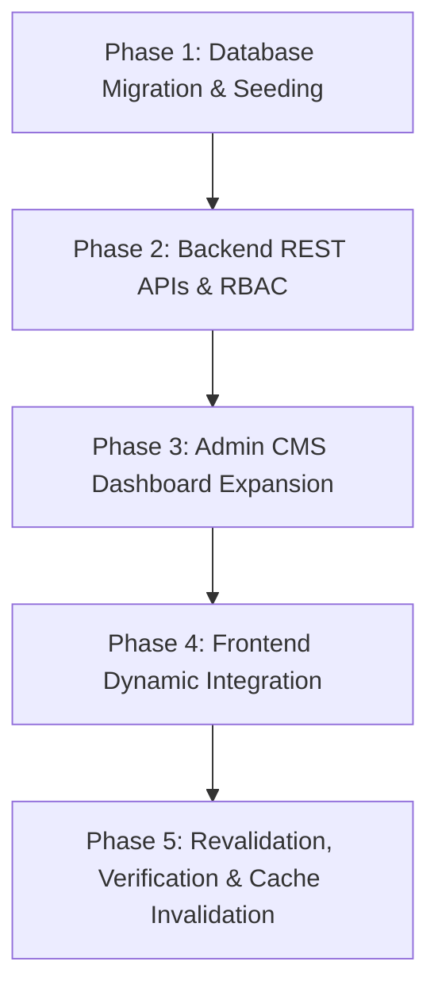

# Technical Audit & Architecture Specification: Dynamic CMS & Content Decoupling
**Project:** OnSupp Agency Website & Admin Panel (`onsupp-redesign`)  
**Audit Date:** November 2026  
**Status:** Complete Audit & Architecture Blueprint  
**Auditor:** Antigravity Advanced Agentic Engineering Team  

---

## Executive Summary

This technical audit delivers an exhaustive inventory and architectural evaluation of the public-facing pages, admin dashboard modules, backend API services, and database schemas of the **OnSupp** agency platform.

The primary objective is to transition OnSupp from a partially hardcoded hybrid application into a **100% dynamically manageable digital agency platform**, enabling editorial, marketing, and leadership teams to create, update, reorder, publish, and translate any website content—without modifying source code or redeploying the application.

### Key Audit Findings
1. **Divergent Services Architecture:** While the backend database maintains an elementary 4-field `Service` model (`title`, `titleEn`, `subtitle`, `subtitleEn`, `imageUrl`), the live website renders seven complex service landing environments featuring 21 detailed subservices, deliverable checklists, 21 numerical metrics, business value narratives, and multi-directional pathways—all of which are hardcoded in frontend TypeScript configuration files (`services-data.ts`, `config/services.ts`).
2. **Dedicated About Page Disconnection:** The standalone `/about` route (`about-hero.tsx`, `intro-values.tsx`, `ceo-profile.tsx`, `team-section.tsx`) contains placeholder models for the CEO profile, core agency values, and eight team members. These elements have zero backing Prisma models, API routes, or CMS admin views.
3. **Clients, Partners & Logo Marquee Untracked:** The prominent "Clients & Partners" showcase (`CLIENT_PARTNERS` with 15 detailed client profiles, quotes, websites, and Instagram handles) and the "Client Logo Marquee" (9 partner brand logos) are completely hardcoded and lack database persistence.
4. **Case Studies Schema Deficit:** The database `CaseStudy` model lacks crucial presentation and editorial fields required by the portfolio detail pages (`servicesFa[]`, `metricsFa[]`, `colorGradient`, `accentColor`, `glowColor`, `previewType`, `challengeFa`, `solutionFa`, and `deliverablesFa[]`), forcing the frontend to perform fallback merging against static data.
5. **Global Coordinates & Navigation in Code:** Header navigation links, mega-menu hierarchies, physical addresses (Karaj & Tehran), direct contact channels (Telegram, phone, email), and global SEO metadata are embedded directly in code.
6. **Publishing & Caching Gaps:** With the exception of `Article` (which has a `published` boolean), entities such as `HeroSlide`, `Service`, `CaseStudy`, `Testimonial`, and `PricingPlan` lack formal draft/published states and on-demand cache invalidation.

---

## 1. Existing Architecture Overview

The OnSupp repository is structured as a modern TypeScript monorepo governed by Turborepo:

```
onsupp-redesign/
├── apps/
│   ├── web/               # Next.js 14+ (App Router), React, Tailwind CSS, Framer Motion
│   └── backend/           # Express.js, TypeScript, Prisma ORM, PostgreSQL
├── services/
│   └── image-manager/     # Supporting media processing sidecar
├── docs/                  # Technical documentation & architecture specifications
├── docker-compose.yml     # Container orchestration (web, backend, db)
└── turbo.json             # Monorepo build and pipeline pipeline orchestration
```

### 1.1 Web Application (`apps/web`)
- **Framework:** Next.js 14+ utilizing the App Router (`app/` directory).
- **Styling & Animation:** Tailwind CSS with custom glassmorphism effects, CSS variables, and Framer Motion for high-fidelity animations.
- **State & Context:** React Context providers (`LanguageContext`, `ThemeContext`) managing bilingual switching (Persian `fa` / English `en`) and theme persistence (dark/light mode).
- **Fonts:** Locally bundled typography (`Vazirmatn` for Persian, `Gendy` for display Latin typography).
- **Data Fetching:** Hybrid strategy combining static fallbacks with client-side React `useEffect` data fetching against the Express API (`${BACKEND_URL}/api/v1/*`).

### 1.2 Backend API Service (`apps/backend`)
- **Runtime & Framework:** Node.js with Express.js written in TypeScript.
- **ORM & Database:** Prisma ORM connected to PostgreSQL.
- **Security & Headers:** `helmet` for HTTP security headers, parameterized `cors` origin validation with development localhost and production whitelisting, and strict JSON body parsing limits (10MB).
- **Authentication & RBAC:**
  - Stateless JSON Web Tokens (JWT) signed via `jsonwebtoken` with environment secret verification (`getJwtSecret()`).
  - Passwords hashed using `bcrypt` (10 salt rounds).
  - Role-Based Access Control enforcing an 8-tier role enum:
    `SUPER_ADMIN`, `ADMIN`, `HR`, `EMPLOYEE`, `CONTENT_SEO_MANAGER`, `SUPPORT`, `PROJECT_MANAGER`, `USER`.
  - Middleware stack: `authenticateToken`, `requireRole([...])`, and automated `AuditLog` recording.
- **Media Storage:** Local disk storage in `apps/backend/uploads/` statically served via Express at `/uploads/*`.

---

## 2. Complete Inventory of Public Website Content

### 2.1 Homepage (`apps/web/app/page.tsx`)
The homepage is composed of ten sequential sections:

| Section # | Component | Primary Displayed Elements | Current Data Source |
|---|---|---|---|
| 1 | `Hero.tsx` | Background image/video slides, headline, subtitle, primary & secondary CTAs (bilingual), pagination dots. | Dynamic via `/api/v1/hero` with fallback to `CANONICAL_HERO_SLIDES`. |
| 2 | `ClientsPartners.tsx` | Carousel of 15 client profiles: company name, industry, year, quote, intro narrative, monogram, links to official websites and Instagram profiles. | **Hardcoded** in `apps/web/config/clients-partners.ts`. |
| 3 | `StatsSatisfaction.tsx` | 4 headline satisfaction metrics (4.9/5 satisfaction, +200 projects, 8 years experience, +15 team members), animated counters, narrative headline. | **Hardcoded** in `apps/web/components/sections/StatsSatisfaction.tsx`. |
| 4 | `Services.tsx` | 7 interactive service cards, background images, category badges, titles, transition effects. | **Hardcoded** in `apps/web/components/sections/Services.tsx` (`SERVICES_DATA`). |
| 5 | `About.tsx` | Agency narrative, eyebrow, main headline, introductory paragraph, CTA button, 4 key feature icons (Team, Data, Support, Results). | Dynamic via `/api/v1/about` (singleton `AboutContent` + `Feature` models), with hardcoded overrides in component. |
| 6 | `ClientLogoMarquee.tsx` | Infinite horizontal scrolling marquee containing 9 client partner logos and clinic emblems. | **Hardcoded** in `apps/web/components/sections/ClientLogoMarquee.tsx` (`CLIENT_LOGOS`). |
| 7 | `CaseStudies.tsx` | Interactive showcase slider of flagship projects, client name, category, metrics, preview mockups, live links. | Hybrid: Fetches `/api/v1/casestudies` and merges missing fields with `SHOWCASE_PROJECTS` from `lib/case-studies.ts`. |
| 8 | `ContactCTA.tsx` | Contact hero text, verified phone pill, consultation email pill, Google Meet request trigger, interactive inquiry form with 7 service categories. | Text dynamic via `/api/v1/contact/content`; submissions to `/api/v1/contact/submissions`; dropdown service options are **hardcoded**. |
| 9 | `Testimonials.tsx` | Swiper slider of client reviews, quotes, client names, job roles, company names, service category tags, star ratings, and avatars. | Dynamic via `/api/v1/testimonials` with fallback to `CANONICAL_TESTIMONIALS`. |
| 10 | `BlogArticles.tsx` | Swiper carousel of latest articles, category tags, publication dates (Persian calendar conversion), reading time, cover images. | Dynamic via `/api/v1/articles` with fallback to `CANONICAL_PREVIEW_ARTICLES`. |

---

### 2.2 Dedicated About Us Page (`apps/web/app/about/page.tsx`)
Managed by `apps/web/lib/about.ts` and rendered via modular components:
1. **Hero Section (`about-hero.tsx`):** Eyebrow, headline ("آدم‌هایی که پشت هر پروژه ایستاده‌اند"), sub-caption, group team photograph.
2. **Intro & Values Section (`intro-values.tsx`):** Editorial narrative, approach philosophy, and three core company principles:
   - *Clarity (شفافیت):* Visible goals and transparent tracking.
   - *Craft (دقت در اجرا):* Attention to detail in design and code.
   - *Partnership (همراهی بلندمدت):* Long-term client support.
3. **CEO Profile Section (`ceo-profile.tsx`):** Founder/CEO portrait, executive quote, multi-paragraph professional biography, and social links (LinkedIn, Twitter).
4. **Team Roster Section (`team-section.tsx`):** 8 team member cards displaying photo placeholders, full names, job titles, department tags, biographies, and social links (LinkedIn, Behance, GitHub, Dribbble, Instagram).

*Status:* **100% hardcoded** in `ABOUT_PAGE_PLACEHOLDER`. Zero backend database models or CMS admin interfaces currently exist for this content.

---

### 2.3 Services Hub Page (`apps/web/app/services/page.tsx`)
Rendered by `ServicesPageView.tsx` using `services-data.ts` (582 lines) and `config/services.ts` (219 lines):
1. **Services Hero (`ServicesHero.tsx`):** Category title, strategic overview, and quick category selector pills.
2. **Services Overview Grid (`ServicesOverviewGrid.tsx`):** 7 high-level service cards with icon triggers.
3. **Services Deep Dive (`ServicesDeepDive.tsx`):**
   Exhaustive presentation of 7 distinct agency practices:
   - `social-identity`: Social Media & Brand Identity
   - `studio-production`: Studio Production & Videography
   - `animation-motion`: Animation & Motion Graphics
   - `web-development`: Custom Web Design & Web Apps
   - `technical-seo`: Technical SEO & Organic Growth
   - `crm-automation`: CRM Implementation & Sales Automation
   - `custom-software`: Enterprise Software Development
   Each practice displays:
   - Index number and bilingual tags (`numStrFa`, `tagFa/En`, `titleFa/En`)
   - Editorial headline and detailed strategic narrative (`detailedNarrativeFa/En`)
   - Business Value statement (`businessValueTitleFa/En`, `businessValueFa/En`)
   - 3 structured Subservices, each containing titles, descriptions, and deliverable checklists (`deliverablesFa[]`)
   - 3 verified numerical KPI metrics (`metricsFa[]`)
   - Multi-directional related pathway links (`relatedLinks[]`)
4. **Services Consultation CTA (`ServicesCTASection.tsx`):** Pre-selected inquiry routing.

*Status:* **100% hardcoded** on the frontend. The existing backend `/api/v1/services` endpoint returns an outdated 4-field schema that is completely ignored by both `/services` and the homepage `Services.tsx`.

---

### 2.4 Portfolio & Case Studies (`/portfolio`, `/portfolio/[slug]`, `/case-studies`)
Rendered via `apps/web/lib/case-studies.ts`:
- **Index Pages (`/portfolio`, `/case-studies`):** Category filter tabs, view toggles, showcase cards with client names, project categories, and cover visuals.
- **Detail Pages (`/portfolio/[slug]`, `/case-studies/[slug]`):**
  - Project Hero with client badge, delivery year, live URL, and preview mockup (web, mobile, or platform).
  - UI color styling: gradient backgrounds (`colorGradient`), accent colors (`accentColor`), and ambient glow (`glowColor`).
  - Project Challenge statement (`challengeFa/En`).
  - Engineered Solution statement (`solutionFa/En`).
  - Key Deliverables list (`deliverablesFa[]`).
  - Numerical impact KPIs (`metricsFa[]`).
  - Secondary visual gallery assets.

*Status:* The detail page (`/portfolio/[slug]`) reads directly from `lib/case-studies.ts` and bypasses the API because the backend `model CaseStudy` does not store deliverables, metrics, challenges, or color styling.

---

### 2.5 Pricing Hub (`apps/web/app/pricing/page.tsx`)
Rendered via `apps/web/lib/pricing.ts`:
- **Categories & Tabs:** SEO, Web Design, Branding, Custom Software.
- **Plan Cards:** Starter, Growth, Enterprise.
- **Card Data:** Plan title, badge, numeric vs custom pricing, period label, description, feature lists, popular highlight, and CTA button.
- **Interactive Calculator & FAQ Accordion:** Supplemental planning components.

*Status:* **Fully dynamic.** Successfully fetches from `/api/v1/pricing/categories` and falls back to `CANONICAL_PRICING_CATEGORIES` when offline.

---

### 2.6 Blog, Articles & Author Pages (`/blog`, `/blog/[slug]`, `/author/[name]`)
Rendered via `apps/web/lib/articles.ts`:
- **Archive Hub (`/blog`):** Category filtering, search bar, pagination (6 items per page), reading times, author attributions, and publication timestamps.
- **Article Detail (`/blog/[slug]`):** Full markdown/HTML content, table of contents, author profile box, translation toggle (cross-linking FA and EN editions), interactive comment submission form, approved comment list, and FAQ schema accordion (`ArticleFaq`).
- **Author Archive (`/author/[name]`):** Dynamic filtering of articles by author.

*Status:* **Fully dynamic.** Fully integrated with `/api/v1/articles` and single slug queries.

---

### 2.7 Shared Layouts, Header, Footer & Global SEO
1. **Header (`Header.tsx`, `NavLinks.tsx`):**
   - Main navigation links (Home, Services, Portfolio, Pricing, Articles, About).
   - Multi-column mega-menu for services featuring icons and subcategories from `config/services.ts`.
   - Language toggle (`fa` / `en`) and Dark/Light theme toggle.
   - Consultation CTA button.
   *Status:* Links and mega-menu data are **hardcoded**.
2. **Footer (`Footer.tsx`):**
   - Brand description.
   - Quick navigation links (`QUICK_LINKS`).
   - Physical address details (`OFFICE_ADDRESS`: Azimiyeh, Kouhnavard Sq, Golestan 21, Karaj, Alborz).
   - Working hours & communication channels (`CONTACT_DETAILS`: Sat-Wed 09:00-18:00, Telegram `@onsupp_web`, Instagram, info@onsupp.ir).
   - Copyright notice and developer credits.
   *Status:* Address, hours, Telegram, and quick links are **hardcoded**.
3. **Global SEO & Metadata (`layout.tsx`, `config/site.ts`):**
   - Canonical site URL (`https://onsupp.ir`), default title templates, meta descriptions, OpenGraph banner images, and Twitter cards.
   *Status:* Hardcoded in `config/site.ts`.

---

## 3. Existing CMS Functionality Assessment

The admin dashboard is located in `apps/web/app/admin/(dashboard)` and communicates with `/api/v1/*` Express routes.

```
apps/web/app/admin/(dashboard)/
├── page.tsx               # Dashboard Home (KPI cards, recent inquiries, system status)
├── hero/page.tsx          # Hero Slides Manager
├── services/page.tsx      # Services Manager (Legacy Schema)
├── about/page.tsx         # About Content Manager (Homepage Singleton only)
├── stats/page.tsx         # Stats Manager (Unused by frontend)
├── casestudies/page.tsx   # Case Studies Manager (Partial fields)
├── pricing/page.tsx       # Pricing Categories & Plans Manager
├── testimonials/page.tsx  # Testimonials Manager
├── articles/page.tsx      # Articles & Blog CMS
├── comments/page.tsx      # Comments Moderation Queue
├── contact/page.tsx       # Inquiries Inbox & Contact Content Editor
├── media/page.tsx         # Media Asset Library
├── users/page.tsx         # User & Role Access Control
└── profile/page.tsx       # Current User Profile Editor
```

### 3.1 Existing Prisma Schema Models (`apps/backend/prisma/schema.prisma`)

```prisma
// Current Models Summary:
model User               // id, email, password, name, role, isActive, phone, department, position, timestamps
model AuditLog           // id, userId, action, targetId, details, ipAddress, createdAt
model Media              // id, url, alt, filename, timestamps
model HeroSlide          // id, title, titleEn, subtitle, subtitleEn, ctaText, ctaLink, imageUrl, position, timestamps
model Service            // id, title, titleEn, subtitle, subtitleEn, imageUrl, imageAlt, position, timestamps
model Stat               // id, kind, valueFa, valueEn, labelFa, labelEn, descFa, descEn, position, timestamps
model AboutContent       // id (1), eyebrowFa, titleFa, ctaFa, ctaLink, imageUrl, subTitleFa, paragraphFa, timestamps
model Feature            // id, titleFa, titleEn, icon, position, timestamps
model CaseStudy          // id, slug, client, titleFa, taglineFa, categoryFa, projectType, descriptionFa, imageUrl, liveUrl, featured, position, year, timestamps
model PricingCategory    // id, titleFa, titleEn, slug, position, timestamps, plans[]
model PricingPlan        // id, categoryId, nameFa, badgeFa, priceType, priceFa, discountPriceFa, periodFa, descriptionFa, featuresFa[], popular, ctaFa, ctaLink, position, timestamps
model ContactContent     // id (1), eyebrowFa, titleFa, descriptionFa, phone, email, responseTimeFa, timestamps
model ContactSubmission  // id, name, phone, email, service, message, read, timestamps
model Article            // id, titleFa, slug, language, categoryFa, excerptFa, contentFa, readTimeFa, imageUrl, author, published, translationId, SEO meta fields, faqs[], comments[]
model ArticleFaq         // id, articleId, question, answer, order, timestamps
model Comment            // id, articleId, name, email, content, approved, reply, timestamps
model Testimonial        // id, quoteFa, authorFa, roleFa, companyFa, serviceTagFa, highlightFa, avatarUrl, isActive, position, timestamps
```

### 3.2 Evaluation of Existing Admin Modules

1. **Articles (`/admin/articles`):**
   - *Maturity:* High.
   - *Capabilities:* Full CRUD, slug uniqueness validation, category assignment, rich excerpt/content editing, multi-language linking (`translationId`), nested FAQ builder, and granular SEO meta tags (`metaTitle`, `metaDesc`, `canonicalUrl`, `keywords`, `ogImage`).
2. **Pricing (`/admin/pricing`):**
   - *Maturity:* High.
   - *Capabilities:* Category creation, slug generation, plan creation with dynamic feature tag inputs, discount pricing, numeric vs contact switch, and popular plan highlighting.
3. **Contact (`/admin/contact`):**
   - *Maturity:* High.
   - *Capabilities:* Inbound submission viewer, read/unread state toggling, submission deletion, and singleton editing of contact hero headings and official email/phone.
4. **Testimonials (`/admin/testimonials`):**
   - *Maturity:* High.
   - *Capabilities:* Full CRUD, author, company, highlight outcome pill, service tag, avatar image link, active toggle, and numeric position sorting.
5. **Hero Slides (`/admin/hero`):**
   - *Maturity:* Medium.
   - *Capabilities:* CRUD for slides, dual CTA text/link pairs, image link, position sorting. Missing: explicit `isPublished` toggle.
6. **Media Library (`/admin/media`):**
   - *Maturity:* Medium-Low.
   - *Capabilities:* Single/multi file upload to local `/uploads`, list view, delete action, copy URL.
   - *Limitations:* Files are written directly to local server disk; no image optimization pipeline, thumbnail generation, WebP conversion, focal point selector, or cloud bucket (S3/R2) synchronization.
7. **Services (`/admin/services`):**
   - *Maturity:* **Obsolete / Disconnected.**
   - *Deficiency:* Edits only primitive 4-field strings. The module does not allow editing subservices, deliverable checklists, metrics, or detailed narratives. Changes made here do not alter `/services` or the homepage.
8. **Case Studies (`/admin/casestudies`):**
   - *Maturity:* **Deficient.**
   - *Deficiency:* Lacks fields for challenge, solution, deliverables list, metrics KPIs, UI color palettes, or preview device types.
9. **About (`/admin/about`):**
   - *Maturity:* **Incomplete.**
   - *Deficiency:* Restricted to the homepage single-card section. Has no interface for the actual `/about` page (CEO profile, core values, team members).
10. **Stats (`/admin/stats`):**
    - *Maturity:* **Orphaned.**
    - *Deficiency:* Backing data is completely bypassed by `StatsSatisfaction.tsx`.

---

## 4. Hardcoded Content Inventory with File Paths

Below is the definitive catalog of every piece of content currently embedded in source code:

| # | File Path | Component / Constant | Hardcoded Elements |
|---|---|---|---|
| 1 | `apps/web/lib/about.ts` | `ABOUT_PAGE_PLACEHOLDER` | Hero title & team photo, intro lead & approach narrative, 3 Core Values (Clarity, Craft, Partnership), CEO profile (quote, 2 bio paragraphs, name), 8 team members (roles, departments, bios, social links). |
| 2 | `apps/web/components/services/services-data.ts` | `DETAILED_SERVICES_DATA` | 582 lines of content for 7 services: headlines, full editorial narratives, business value titles & descriptions, 21 subservices with deliverable lists, 21 numerical KPI counters, and 28 related pathway links. |
| 3 | `apps/web/config/services.ts` | `SERVICES_MENU_ITEMS` | Mega-menu navigation data: 7 service categories, titles, tags, descriptions, subservice summaries, and icon mappings. |
| 4 | `apps/web/config/clients-partners.ts` | `CLIENT_PARTNERS` | 423 lines of content for 15 client profiles: company names, client quotes, industry tags, years of engagement, monograms, official website URLs, and Instagram handles. |
| 5 | `apps/web/components/sections/ClientLogoMarquee.tsx` | `CLIENT_LOGOS` | 9 client logo items with hardcoded filenames, dimensions (width/height), and Persian/English brand titles. |
| 6 | `apps/web/components/sections/StatsSatisfaction.tsx` | `metrics` (Lines 131–200) | 4 headline statistics: 4.9/5 satisfaction, +200 completed projects, 8 years experience, +15 team members, with titles and SVG icons. |
| 7 | `apps/web/lib/case-studies.ts` | `SHOWCASE_PROJECTS` | Deep case study data: challenge texts, solution texts, deliverable arrays, metrics counters (`metricsFa/En`), color gradients, accent colors, and glow values. |
| 8 | `apps/web/components/sections/About.tsx` | Lines 55–121 & 163–167 | Hardcoded default features array and manual code override replacing API `titleFa` with `"آنساپ؛ فراتر از یک تیم دیجیتال"`. |
| 9 | `apps/web/components/sections/Services.tsx` | `SERVICES_DATA` (Lines 33–100) | Homepage services list of 7 items with hardcoded slugs, tags, titles, and image paths. |
| 10 | `apps/web/components/sections/ContactCTA.tsx` | Lines 283–296 | Hardcoded `<option>` elements in the inquiry form service dropdown. |
| 11 | `apps/web/components/layout/Footer.tsx` | Lines 39–76 | Quick navigation links (`QUICK_LINKS`), physical office address in Karaj (`OFFICE_ADDRESS`), working hours, Telegram handle (`@onsupp_web`), and Instagram URL. |
| 12 | `apps/web/components/layout/NavLinks.tsx` | `translations` (Lines 11–28) | Primary header navigation items (Home, Services, Portfolio, Pricing, Articles, About). |
| 13 | `apps/web/config/site.ts` | `siteConfig` (Lines 10–48) | Global site metadata, SEO title template, default description, keywords, publisher, and social links. |

---

## 5. Content Management Matrix

The following matrix classifies every content element across the entire website, its current source, CMS status, and required architectural action.

| Website Area | Content Element | Current Source | Existing CMS Module | API Status | Dynamic Status | Required Action |
|---|---|---|---|---|---|---|
| **Header** | Primary Menu Links | `NavLinks.tsx` | None | No API | **Hardcoded** | Create `NavigationMenu` model & settings API endpoint. |
| **Header** | Services Mega-Menu | `config/services.ts` | `/admin/services` | Partial API | **Hardcoded** | Derive mega-menu directly from published dynamic `Service` records. |
| **Header** | Brand Logo & Theme Toggles | `Header.tsx` | None | No API | Code Standard | Keep UI controls in code; manage logo URL via `SiteSettings`. |
| **Hero Section** | Hero Slides & CTAs | Database / API | `/admin/hero` | Active (`/hero`) | **Already fully dynamic** | Add `isPublished` boolean field to schema. |
| **Clients & Partners** | 15 Client Profiles & Quotes | `clients-partners.ts` | None | No API | **Missing CMS functionality** | Create `ClientPartner` model, API CRUD, and admin view. |
| **Satisfaction Stats** | 4 KPI Counters & Headline | `StatsSatisfaction.tsx` | `/admin/stats` | Active (`/stats`) | **Hardcoded** | Update `StatsSatisfaction.tsx` to consume `/api/v1/stats`. |
| **Services Section** | 7 Homepage Service Cards | `Services.tsx` | `/admin/services` | Disconnected | **Hardcoded** | Connect `Services.tsx` to updated `/api/v1/services` endpoint. |
| **About (Home)** | Card Copy & Features | Database / API | `/admin/about` | Active (`/about`) | **Partially dynamic** | Remove hardcoded title override in `About.tsx`; honor CMS data. |
| **Client Marquee** | 9 Partner Brand Logos | `ClientLogoMarquee.tsx` | None | No API | **Missing CMS functionality** | Create `ClientLogo` model, API CRUD, and admin view. |
| **Case Studies (Home)** | Featured Project Showcase | Hybrid API + TS | `/admin/casestudies` | Incomplete | **Partially dynamic** | Expand `CaseStudy` schema to store deliverables, metrics, and styling. |
| **Contact CTA** | Hero Copy, Email, Phone | Database / API | `/admin/contact` | Active (`/contact`) | **Already fully dynamic** | Allow dynamic phone visibility without hardcoded bypass checks. |
| **Contact CTA** | Services Dropdown Options | `ContactCTA.tsx` | None | No API | **Hardcoded** | Populate select options dynamically from published `Service` titles. |
| **Testimonials** | Client Reviews & Star Ratings | Database / API | `/admin/testimonials` | Active (`/testimonials`) | **Already fully dynamic** | Maintain existing robust implementation. |
| **Blog Articles (Home)** | Recent Articles Carousel | Database / API | `/admin/articles` | Active (`/articles`) | **Already fully dynamic** | Maintain existing robust implementation. |
| **About Us Page** | Hero Headline & Team Photo | `lib/about.ts` | None | No API | **Missing CMS functionality** | Create `AboutPage` singleton model or extend `AboutContent`. |
| **About Us Page** | 3 Agency Core Values | `lib/about.ts` | None | No API | **Missing CMS functionality** | Create `CompanyValue` model, API endpoints, and admin tab. |
| **About Us Page** | CEO Profile & Narrative | `lib/about.ts` | None | No API | **Missing CMS functionality** | Create `CeoProfile` singleton model, API CRUD, and admin tab. |
| **About Us Page** | 8 Team Member Profiles | `lib/about.ts` | None | No API | **Missing CMS functionality** | Create `TeamMember` model, API CRUD, and admin module. |
| **Services Hub** | 7 Deep-Dive Services | `services-data.ts` | `/admin/services` | Outdated API | **Missing CMS functionality** | Overhaul `Service` model with JSON fields or relational subservices. |
| **Services Hub** | 21 Subservices & Deliverables | `services-data.ts` | None | No API | **Missing CMS functionality** | Model subservices with deliverable lists in backend schema. |
| **Services Hub** | 21 Service KPI Metrics | `services-data.ts` | None | No API | **Missing CMS functionality** | Store metrics within `Service` model. |
| **Services Hub** | Related Service Pathways | `services-data.ts` | None | No API | **Missing CMS functionality** | Store cross-service pathway links in `Service` model. |
| **Portfolio Index** | Showcase Cards & Filters | Hybrid API + TS | `/admin/casestudies` | Incomplete | **Partially dynamic** | Supply full project attributes from backend. |
| **Portfolio Details** | Challenge & Solution Texts | `lib/case-studies.ts` | None | No API | **Missing CMS functionality** | Add `challengeFa/En` and `solutionFa/En` to `CaseStudy`. |
| **Portfolio Details** | Deliverables Checklists | `lib/case-studies.ts` | None | No API | **Missing CMS functionality** | Add `deliverablesFa[]` and `deliverablesEn[]` to `CaseStudy`. |
| **Portfolio Details** | Project Impact Metrics | `lib/case-studies.ts` | None | No API | **Missing CMS functionality** | Add `metricsFa` / `metricsEn` JSON fields to `CaseStudy`. |
| **Portfolio Details** | UI Colors & Device Mockup | `lib/case-studies.ts` | None | No API | **Missing CMS functionality** | Add `colorGradient`, `accentColor`, and `previewType` to `CaseStudy`. |
| **Pricing Hub** | Categories & Plans | Database / API | `/admin/pricing` | Active (`/pricing`) | **Already fully dynamic** | Add `isPublished` boolean field to `PricingPlan`. |
| **Blog Index** | Paginated Post Archive | Database / API | `/admin/articles` | Active (`/articles`) | **Already fully dynamic** | Maintain existing robust implementation. |
| **Blog Post Single** | Markdown, FAQs, Comments | Database / API | `/admin/articles` | Active (`/articles`) | **Already fully dynamic** | Maintain existing robust implementation. |
| **Author Archive** | Filtered Author Post Archive | Database / API | `/admin/articles` | Active (`/articles`) | **Already fully dynamic** | Optional: link `author` string to a `TeamMember` foreign key. |
| **Footer** | Office Address & Hours | `Footer.tsx` | None | No API | **Hardcoded** | Move office address, hours, and Telegram to `SiteSettings`. |
| **Footer** | Quick Navigation Links | `Footer.tsx` | None | No API | **Hardcoded** | Populate footer navigation from global site settings. |
| **Global SEO** | Canonical URL, Meta & OG | `config/site.ts` | None | No API | **Hardcoded** | Create `SiteSettings` model to manage default SEO tags. |

---

## 6. Missing CMS Functionality Analysis

The audit identifies seven core functional voids in the existing CMS:

### 6.1 Team & Leadership Management
The `/about` page currently displays a founder/CEO profile and eight multidisciplinary team members. Currently:
- There is no database table for team members or executive leadership.
- There is no admin interface to add new employees, update job roles, edit biographical paragraphs, upload portraits, or update LinkedIn/Behance links.
- When personnel changes occur, code changes in `lib/about.ts` are required.

### 6.2 Company Values & Philosophy
The three foundational agency values (*Clarity*, *Craft*, *Partnership*) on `/about` are hardcoded. The marketing team cannot refine value descriptions, change icons, or add new principles without engineering intervention.

### 6.3 Client Roster & Partner Logos
- **15 Client Partner Stories:** The interactive carousel showcasing Dr. Miresmaeli, Dr. Hatam, Shin Beauty Center, Najma Tavakolian, Canza Construction, etc. has no database representation.
- **Logo Marquee:** Brand logos in `ClientLogoMarquee.tsx` cannot be updated, reordered, or added without modifying React code.

### 6.4 Service Deep-Dive Architecture
The existing `Service` model is fundamentally disconnected from the actual service offerings:
- It lacks fields for the 3 subservices per category (21 total).
- It lacks deliverable checklists per subservice (e.g., "سئو داخلی و تکنیکال", "آنالیز لاگ‌های سرور").
- It lacks the 3 KPI metric counters displayed in each service tab.
- It lacks the extended business value statement and deep narrative copy.

### 6.5 Rich Case Study History
The existing `CaseStudy` model only accommodates basic card metadata. When users navigate to `/portfolio/[slug]`, the page expects structured challenge/solution sections, deliverable tags, and quantitative outcome metrics. Because these fields are absent in the database, the frontend is forced to bypass the API and read from static files.

### 6.6 Global Site Settings & Navigation
There is no unified "Global Settings" module in the admin dashboard. As a result:
- Changes to office address, studio location, or operating hours require editing `Footer.tsx`.
- Adjusting official social media handles (Telegram, Instagram, LinkedIn) requires editing components.
- Header navigation items cannot be reordered or renamed from the CMS.

### 6.7 Granular Draft / Publishing Workflow
Currently, only `Article` has a `published` boolean flag. If an admin edits a `HeroSlide`, `Service`, `CaseStudy`, `Testimonial`, or `PricingPlan`, the changes take effect immediately on production. There is no mechanism to save work in draft state, preview unpublished entries, or schedule publishing.

---

## 7. Recommended Database Architecture

To make all content dynamic without breaking existing functionality, we propose additive schema extensions to `apps/backend/prisma/schema.prisma`. Existing models retain all current fields, while new fields are defined as optional or with default values to guarantee 100% backward compatibility.

### 7.1 Proposed Prisma Schema Extensions

```prisma
// ============================================================================
// 1. GLOBAL SETTINGS & NAVIGATION
// ============================================================================

model SiteSettings {
  id              Int      @id @default(1)
  siteNameFa      String   @default("آن‌ساپ")
  siteNameEn      String   @default("OnSupp")
  siteTitleFa     String   @default("آژانس دیجیتال مارکتینگ و توسعه نرم‌افزار آن‌ساپ")
  siteTitleEn     String   @default("OnSupp | Digital Agency & Software Engineering")
  siteDescFa      String   @default("ارائه‌دهنده راهکارهای هوشمند طراحی وب‌سایت‌های سازمانی، سئو تکنیکال و برندینگ.")
  siteDescEn      String   @default("Enterprise web engineering, technical SEO, and brand growth agency.")
  defaultKeywords String   @default("دیجیتال مارکتینگ, طراحی سایت, سئو تکنیکال, آن‌ساپ")
  ogImageUrl      String   @default("/images/logo/logo-Crimson.webp")
  
  // Office Coordinates & Contact
  phone           String   @default("")
  email           String   @default("info@onsupp.ir")
  telegramHandle  String   @default("onsupp_web")
  telegramUrl     String   @default("https://t.me/onsupp_web")
  instagramUrl    String   @default("https://instagram.com/onsupp_web")
  linkedinUrl     String   @default("https://linkedin.com/company/onsupp")
  addressFa       String   @default("البرز، کرج، منطقه عظیمیه، میدان کوهنورد، گلستان ۲۱")
  addressEn       String   @default("Golestan 21, Kouhnavard Sq, Azimiyeh, Karaj, Iran")
  workingHoursFa  String   @default("شنبه تا چهارشنبه ۹:۰۰ تا ۱۸:۰۰")
  workingHoursEn  String   @default("Sat - Wed: 09:00 - 18:00")
  googleMapsUrl   String   @default("https://maps.google.com/?q=35.8340,51.0110")
  
  // Navigation & Footer JSON Configurations
  headerNavJson   Json?    // Array of { nameFa, nameEn, href, isServices, position }
  footerLinksJson Json?    // Array of { nameFa, nameEn, href, position }

  updatedAt       DateTime @updatedAt
  createdAt       DateTime @default(now())

  @@map("site_settings")
}

// ============================================================================
// 2. LEADERSHIP, TEAM & ABOUT PAGE
// ============================================================================

model CeoProfile {
  id          Int      @id @default(1)
  nameFa      String   @default("نام مدیرعامل")
  nameEn      String   @default("CEO Name")
  roleFa      String   @default("بنیان‌گذار و مدیرعامل")
  roleEn      String   @default("Founder & CEO")
  quoteFa     String   @default("ما آن‌ساپ را ساختیم تا برندها مجبور نباشند بین خلاقیت و نتیجه یکی را انتخاب کنند.")
  quoteEn     String   @default("We built OnSupp so brands never have to choose between creativity and results.")
  bioFa       String[] @default([]) // Array of biographical paragraphs
  bioEn       String[] @default([])
  avatarUrl   String?
  focalPoint  String   @default("50% 50%")
  socialLinks Json     @default("[]") // Array of { platform, url }
  updatedAt   DateTime @updatedAt
  createdAt   DateTime @default(now())

  @@map("ceo_profile")
}

model TeamMember {
  id           Int      @id @default(autoincrement())
  nameFa       String
  nameEn       String
  roleFa       String
  roleEn       String
  departmentFa String
  departmentEn String
  bioFa        String   @default("")
  bioEn        String   @default("")
  avatarUrl    String?
  focalPoint   String   @default("50% 50%")
  socialLinks  Json     @default("[]") // Array of { platform, url }
  position     Int      @default(0)
  isPublished  Boolean  @default(true)
  updatedAt    DateTime @updatedAt
  createdAt    DateTime @default(now())

  @@index([position])
  @@index([isPublished])
  @@map("team_members")
}

model CompanyValue {
  id            Int      @id @default(autoincrement())
  key           String   @unique // e.g. "clarity", "craft", "partnership"
  titleFa       String
  titleEn       String
  descriptionFa String
  descriptionEn String
  badgeFa       String   @default("")
  badgeEn       String   @default("")
  icon          String   @default("check")
  position      Int      @default(0)
  isPublished   Boolean  @default(true)
  updatedAt     DateTime @updatedAt
  createdAt     DateTime @default(now())

  @@index([position])
  @@map("company_values")
}

// ============================================================================
// 3. CLIENTS, PARTNERS & LOGO MARQUEE
// ============================================================================

model ClientPartner {
  id              Int      @id @default(autoincrement())
  slug            String   @unique // e.g. "najma-tavakolian", "dr-hatam"
  orderNumber     String   @default("01")
  nameFa          String
  nameEn          String
  titleFa         String
  titleEn         String
  industryFa      String
  industryEn      String
  introFa         String
  introEn         String
  quoteFa         String?
  quoteEn         String?
  yearFa          String   @default("۱۴۰۳")
  yearEn          String   @default("2024")
  monogram        String   @default("ON")
  portraitImage   String?
  portraitBadgeFa String?
  portraitBadgeEn String?
  websites        Json     @default("[]") // Array of { url, label }
  instagrams      Json     @default("[]") // Array of { handle, profileUrl, name }
  servicesFa      String[] @default([])
  servicesEn      String[] @default([])
  position        Int      @default(0)
  isFeatured      Boolean  @default(true)
  isPublished     Boolean  @default(true)
  updatedAt       DateTime @updatedAt
  createdAt       DateTime @default(now())

  @@index([position])
  @@index([isPublished])
  @@map("client_partners")
}

model ClientLogo {
  id          Int      @id @default(autoincrement())
  key         String   @unique // e.g. "sina-parsipour", "night-sky"
  nameFa      String
  nameEn      String
  logoUrl     String
  darkLogoUrl String?
  width       Int      @default(300)
  height      Int      @default(120)
  linkUrl     String?  @default("#")
  position    Int      @default(0)
  isPublished Boolean  @default(true)
  updatedAt   DateTime @updatedAt
  createdAt   DateTime @default(now())

  @@index([position])
  @@index([isPublished])
  @@map("client_logos")
}

// ============================================================================
// 4. EXTENDED SERVICE MODEL (Upgrades existing `model Service`)
// ============================================================================

// Existing model Service upgraded with optional fields for full backward compatibility:
// model Service {
//   id                     Int      @id @default(autoincrement())
//   slug                   String   @unique @default("") // e.g. "social-identity"
//   tagFa                  String   @default("")
//   tagEn                  String   @default("")
//   title                  String   @default("") // titleFa
//   titleEn                String   @default("")
//   subtitle               String   @default("")
//   subtitleEn             String   @default("")
//   headlineFa             String   @default("")
//   headlineEn             String   @default("")
//   detailedNarrativeFa    String   @default("")
//   detailedNarrativeEn    String   @default("")
//   businessValueTitleFa   String   @default("")
//   businessValueTitleEn   String   @default("")
//   businessValueFa        String   @default("")
//   businessValueEn        String   @default("")
//   iconType               String   @default("web") // "social" | "studio" | "motion" | "web" | "seo" | "crm" | "software"
//   imageUrl               String?
//   imageAlt               String?
//   badgeAccentFa          String?
//   badgeAccentEn          String?
//   ctaLabelFa             String   @default("درخواست مشاوره این خدمت")
//   ctaLabelEn             String   @default("Request Service Consultation")
//   
//   // Structured Components stored as clean JSON schemas:
//   subservices            Json     @default("[]") // Array of { nameFa, nameEn, descFa, descEn, deliverablesFa[], deliverablesEn[] }
//   metrics                Json     @default("[]") // Array of { valueFa, valueEn, labelFa, labelEn }
//   relatedLinks           Json     @default("[]") // Array of { titleFa, titleEn, href, type }
//   
//   position               Int      @default(0)
//   isPublished            Boolean  @default(true)
//   updatedAt              DateTime @updatedAt
//   createdAt              DateTime @default(now())
//   @@map("services")
// }

// ============================================================================
// 5. EXTENDED CASE STUDY MODEL (Upgrades existing `model CaseStudy`)
// ============================================================================

// Existing model CaseStudy upgraded with rich portfolio attributes:
// model CaseStudy {
//   id             Int      @id @default(autoincrement())
//   slug           String   @unique @default("")
//   client         String   @default("")
//   clientEn       String   @default("")
//   titleFa        String   @default("")
//   titleEn        String   @default("")
//   taglineFa      String   @default("")
//   taglineEn      String   @default("")
//   categoryFa     String   @default("")
//   categoryEn     String   @default("")
//   projectType    String   @default("website")
//   descriptionFa  String   @default("")
//   descriptionEn  String   @default("")
//   imageUrl       String?
//   secondaryImage String?
//   liveUrl        String   @default("#")
//   featured       Boolean  @default(true)
//   position       Int      @default(0)
//   year           String   @default("۲۰۲۵")
//   
//   // New Rich Fields:
//   challengeFa    String   @default("")
//   challengeEn    String   @default("")
//   solutionFa     String   @default("")
//   solutionEn     String   @default("")
//   deliverablesFa String[] @default([])
//   deliverablesEn String[] @default([])
//   servicesFa     String[] @default([])
//   servicesEn     String[] @default([])
//   metricsFa      Json     @default("[]") // Array of { value, label }
//   metricsEn      Json     @default("[]")
//   colorGradient  String   @default("from-[#1a1315] via-[#241a1e] to-[#100b0d]")
//   accentColor    String   @default("#D4A5A8")
//   glowColor      String   @default("rgba(212, 165, 168, 0.2)")
//   previewType    String   @default("web") // "mobile" | "web" | "platform"
//   isPublished    Boolean  @default(true)
//   
//   updatedAt      DateTime @updatedAt
//   createdAt      DateTime @default(now())
//   @@map("case_studies")
// }
```

---

## 8. Required API Changes

All endpoints must be mounted under `/api/v1/*`. Public routes return only records where `isPublished: true` or `isActive: true`. Protected routes enforce JWT token verification and require administrative roles (`ADMIN` or `SUPER_ADMIN`).

### 8.1 New REST API Endpoints

| Method | Endpoint | Access | Purpose |
|---|---|---|---|
| `GET` | `/api/v1/settings` | Public | Return global site metadata, office coordinates, social handles, and navigation. |
| `PUT` | `/api/v1/settings` | Admin | Update global site settings and navigation configurations. |
| `GET` | `/api/v1/about-page` | Public | Consolidated endpoint returning hero copy, values, CEO profile, and active team members. |
| `GET` | `/api/v1/team` | Public | Return published team members sorted by `position ASC`. |
| `POST` | `/api/v1/team` | Admin | Create a new team member. |
| `PUT` | `/api/v1/team/:id` | Admin | Update a team member's bio, role, photo, or order. |
| `DELETE` | `/api/v1/team/:id` | Admin | Delete a team member. |
| `GET` | `/api/v1/ceo` | Public | Return CEO profile data. |
| `PUT` | `/api/v1/ceo` | Admin | Update CEO profile data, quote, paragraphs, and portrait. |
| `GET` | `/api/v1/values` | Public | Return published company values. |
| `PUT` | `/api/v1/values/:id` | Admin | Update company value titles, descriptions, or order. |
| `GET` | `/api/v1/clients` | Public | Return published client partners sorted by `position ASC`. |
| `POST` | `/api/v1/clients` | Admin | Create a new client partner profile. |
| `PUT` | `/api/v1/clients/:id` | Admin | Update client partner information, quotes, or social links. |
| `DELETE` | `/api/v1/clients/:id` | Admin | Delete a client partner record. |
| `GET` | `/api/v1/client-logos` | Public | Return published client marquee logos sorted by `position ASC`. |
| `POST` | `/api/v1/client-logos` | Admin | Add a new client marquee logo. |
| `PUT` | `/api/v1/client-logos/:id` | Admin | Update logo metadata or display order. |
| `DELETE` | `/api/v1/client-logos/:id` | Admin | Delete a client logo. |
| `POST` | `/api/v1/revalidate` | Admin / Hook | Trigger Next.js on-demand ISR revalidation for specified tags. |

### 8.2 Updated Existing Endpoints

1. **`GET /api/v1/services`:**
   - Add query support: `GET /api/v1/services?slug=:slug`.
   - Return full structured payloads including `subservices`, `metrics`, `businessValue`, and `relatedLinks`.
   - Filter `isPublished: true` for unauthenticated requests.
2. **`GET /api/v1/casestudies` & `GET /api/v1/casestudies/:slug`:**
   - Return new fields: `challengeFa/En`, `solutionFa/En`, `deliverablesFa/En`, `metricsFa/En`, and styling properties.
   - Remove the need for frontend fallback merging against `SHOWCASE_PROJECTS`.
3. **`GET /api/v1/stats`:**
   - Ensure the seeded stats match the 4 verified metrics used in `StatsSatisfaction.tsx` (Score, Projects, Experience, Team).
4. **`GET /api/v1/hero`:**
   - Filter `where: { isPublished: true }`.

---

## 9. Recommended Admin Dashboard Structure

The admin sidebar should be organized into four logical clusters to streamline daily editorial workflows:

```
ADMIN CONSOLE
│
├── 📁 1. CONTENT & SECTIONS
│   ├── Hero Slides                 (/admin/hero)
│   ├── Services & Subservices      (/admin/services)       [UPGRADED]
│   ├── Case Studies & Portfolio    (/admin/casestudies)    [UPGRADED]
│   ├── Clients & Partners          (/admin/clients)        [NEW]
│   ├── Client Logos Marquee        (/admin/client-logos)   [NEW]
│   ├── Satisfaction Statistics     (/admin/stats)          [ALIGNED]
│   ├── Testimonials                (/admin/testimonials)
│   └── About Us & Leadership       (/admin/about-team)     [NEW UNIFIED MODULE]
│       ├── Tab 1: Homepage About Card
│       ├── Tab 2: Core Values (3 Principles)
│       ├── Tab 3: CEO Profile & Biography
│       └── Tab 4: Team Member Directory
│
├── 📝 2. EDITORIAL & ARTICLES
│   ├── Blog Articles               (/admin/articles)
│   ├── Article FAQs                (/admin/articles)
│   └── Comments Moderation         (/admin/comments)
│
├── 💼 3. PRICING & INQUIRIES
│   ├── Pricing Plans & Categories  (/admin/pricing)
│   └── Contact Inquiries Inbox     (/admin/contact)
│
└── ⚙️ 4. SYSTEM & ASSETS
    ├── Media Library               (/admin/media)
    ├── Global Site Settings & SEO  (/admin/settings)       [NEW]
    ├── User & Role Management      (/admin/users)
    └── Activity Audit Logs         (/admin/audit-logs)
```

### 9.1 Recommended Admin UI Component Patterns
- **Bilingual Tab Switcher:** Every form field should offer a Persian (`fa`) and English (`en`) tab switch to maintain clear parity between translations.
- **Visual Media Picker Modal:** Replace raw text URL inputs with an interactive modal that connects directly to `/admin/media`, allowing editors to select existing assets or upload new ones.
- **Nested List & Checklist Builders:** Provide an intuitive key-value tag input for deliverables, subservices, and metrics arrays without requiring manual JSON editing.
- **Instant Publish Toggle:** A top-level status bar with an active toggle (`Draft` / `Published`) and "Preview on Site" button.

---

## 10. Implementation Roadmap

The implementation is broken into five sequential phases to ensure smooth progression with zero downtime:



### Phase 1: Database Schema Expansion & Seed Migration (Priority 1)
- **Dependencies:** None.
- **Tasks:**
  1. Add proposed models (`SiteSettings`, `CeoProfile`, `TeamMember`, `CompanyValue`, `ClientPartner`, `ClientLogo`) and update `Service` and `CaseStudy` in `schema.prisma`.
  2. Create and run Prisma migration: `npx prisma migrate dev --name expand_dynamic_cms`.
  3. Author a comprehensive seed script (`seed-cms.ts`) migrating all current static data from `services-data.ts`, `clients-partners.ts`, `ClientLogoMarquee.tsx`, and `lib/about.ts` into PostgreSQL.
  4. Verify data integrity in PostgreSQL.

### Phase 2: Backend REST APIs & Validation (Priority 2)
- **Dependencies:** Phase 1.
- **Tasks:**
  1. Create routes and controllers: `settings.ts`, `team.ts`, `values.ts`, `clients.ts`, `client-logos.ts`.
  2. Update `services.ts` and `casestudies.ts` controllers to handle nested JSON fields.
  3. Implement Zod request payload validation.
  4. Apply `authenticateToken` and `requireRole` middleware to all mutation routes.
  5. Add audit log entries for every create, update, and delete action.

### Phase 3: Admin CMS Dashboard Expansion (Priority 3)
- **Dependencies:** Phase 2.
- **Tasks:**
  1. Create new admin pages: `/admin/settings`, `/admin/clients`, `/admin/client-logos`, and `/admin/about-team`.
  2. Overhaul `/admin/services` with subservice and deliverables array builders.
  3. Overhaul `/admin/casestudies` to edit challenges, solutions, deliverables, and metric KPIs.
  4. Build reusable `MediaPickerModal` component for asset selection.

### Phase 4: Frontend Hydration & Dynamic Data Integration (Priority 4)
- **Dependencies:** Phase 2.
- **Tasks:**
  1. Update `/about` page components (`intro-values.tsx`, `ceo-profile.tsx`, `team-section.tsx`) to consume `/api/v1/about-page`.
  2. Update `/services` and `Services.tsx` to consume `/api/v1/services`.
  3. Update `ClientsPartners.tsx` to consume `/api/v1/clients`.
  4. Update `ClientLogoMarquee.tsx` to consume `/api/v1/client-logos`.
  5. Update `StatsSatisfaction.tsx` to consume `/api/v1/stats`.
  6. Update `/portfolio/[slug]` to fetch full case study payloads from the API.
  7. Update `Footer.tsx` and `Header.tsx` to consume dynamic coordinates and menus from `/api/v1/settings`.
  8. Retain existing local constants as offline fallbacks.

### Phase 5: Revalidation, Verification & Cache Invalidation (Priority 5)
- **Dependencies:** Phases 3 & 4.
- **Tasks:**
  1. Implement Next.js on-demand ISR revalidation tags (`revalidateTag`) for `services`, `about`, `case-studies`, `clients`, `settings`.
  2. Connect backend mutation endpoints to ping Next.js `/api/revalidate` on publish.
  3. Test full end-to-end editorial flow: create/edit in admin panel -> immediate reflection on public pages without build or redeploy.
  4. Conduct performance and Core Web Vitals checks.

---

## 11. Risks, Backward Compatibility & Security Considerations

### 11.1 Zero-Downtime Backward Compatibility
- **Additive Schema Updates:** All new database columns must be either optional (`?`) or carry sensible default values (`@default(...)`). No existing columns will be dropped or renamed.
- **Graceful Fallback Pattern:** Frontend components will implement the proven fallback pattern already established in `pricing.ts` and `articles.ts`:
  ```typescript
  const [data, setData] = useState<T>(FALLBACK_DATA);
  useEffect(() => {
    fetch(`${BACKEND_URL}/api/v1/...`)
      .then(res => res.ok ? res.json() : null)
      .then(apiData => { if (apiData) setData(apiData); })
      .catch(() => { /* keep fallback data seamlessly */ });
  }, []);
  ```
  If the database or API is temporarily unreachable during maintenance, the website renders fallback data without crashing or showing blank screens.

### 11.2 Cache Invalidation Strategy
To guarantee fast page response times while ensuring published CMS changes appear immediately:
1. **App Router Server Fetching:** Use Next.js fetch cache with tags:
   ```typescript
   fetch(`${BACKEND_URL}/api/v1/services`, { next: { tags: ['services'] } })
   ```
2. **On-Demand Webhook Revalidation:** When an administrator publishes or updates an entry in the CMS, the Express backend sends a signed request to the Next.js API route:
   ```typescript
   POST /api/revalidate?tag=services&secret=...
   ```
   Next.js invokes `revalidateTag('services')`, refreshing the cached page without a server restart.

### 11.3 Security & Role Permissions
- Public endpoints must never expose draft content, unapproved comments, user emails, or internal audit logs.
- Public routes must strictly enforce `where: { isPublished: true }`.
- Admin routes must preserve existing RBAC guards (`Role.SUPER_ADMIN`, `Role.ADMIN`, `Role.CONTENT_SEO_MANAGER`).
- Rich text fields (biographies, articles, descriptions) must be sanitized before rendering to eliminate Cross-Site Scripting (XSS) risks.

---

## Conclusion & Next Steps

This audit establishes a complete and actionable blueprint to transition OnSupp into an entirely dynamic, self-serve digital agency platform. 

Implementation will begin once the architectural decisions outlined below are approved by stakeholders.


---

# Part II: Task 02 Backend Foundation Implementation Report

## 1. Overview & Verification Status
The backend and database foundation for the dynamic CMS was successfully implemented, verified, and benchmarked against PostgreSQL 16 on port 5434. All public-facing content modules now operate with full dynamic data persistence, draft isolation, role-based access control (RBAC), and server-to-server cache revalidation.

- **Baseline Pre-Implementation Backup:** `backups/pre_task02_backup.sql` (Verified: 95,351 bytes)
- **Active Migration Applied:** `20261105110000_implement_dynamic_cms_foundation`
- **Prisma Client Generation:** Up to date (`v6.19.3`)
- **Automated Verification:** 31/31 E2E tests passed (100%), 36/36 RBAC tests passed (100%)

---

## 2. Database Models Created and Extended

### 2.1 New Enum & Models
1. **`PublicationStatus` Enum:**
   - Values: `DRAFT`, `PUBLISHED`, `ARCHIVED`
   - Governs content lifecycles across all public entities.

2. **`SiteSettings` (Singleton, ID: 1):**
   - Stores global brand identity, site names, SEO titles, descriptions, keyword arrays, canonical URLs.
   - Comprehensive contact channels: primary phone, secondary phone, labels, email addresses, response times.
   - Physical address, coordinates, Google Maps URL, working hours.
   - Social channels: Telegram, Instagram, LinkedIn.
   - Brand assets: header logo (light/dark), footer logo, OG share image, favicon.
   - Global navigation: `headerNavJson` and `footerLinks`.

3. **`ClientPartner` (15 fields):**
   - Independent entity for flagship clients and featured partners.
   - Relational fields: `slug` (unique), `nameFa`, `nameEn`, `titleFa`, `titleEn`, `badgeFa`, `badgeEn`, `monogram`, `monogramEn`.
   - Contact & web references: `websites` (JSON), `instagrams` (JSON).
   - Display & status: `serviceTagsFa`, `serviceTagsEn`, `portraitImage`, `portraitBadgeFa/En`, `isFeatured`, `position`, `isPublished`, `status`.

4. **`ClientLogo` (12 fields):**
   - Marquee and client logo carousel management.
   - Fields: `key` (unique), `nameFa`, `nameEn`, `logoUrl`, `darkLogoUrl`, `altFa`, `altEn`, `width`, `height`, `linkUrl`, `position`, `isPublished`, `status`.

5. **`TeamMember` (14 fields):**
   - Core team members and leadership profiles.
   - Fields: `nameFa`, `nameEn`, `roleFa`, `roleEn`, `departmentFa`, `departmentEn`, `bioFa`, `bioEn`, `avatarUrl`, `additionalImages` (JSON), `focalPoint`, `socialLinks` (JSON), `position`, `isPublished`, `status`.

6. **`CeoProfile` (Singleton, ID: 1):**
   - Executive profile for the `/about` page and press kits.
   - Fields: `nameFa`, `nameEn`, `roleFa`, `roleEn`, `quoteFa`, `quoteEn`, `bioFa` (string array), `bioEn` (string array), `avatarUrl`, `focalPoint`, `socialLinks` (JSON), `isPublished`, `status`.

7. **`CompanyValue` (11 fields):**
   - Core organizational principles (Clarity, Craft, Partnership).
   - Fields: `key` (unique), `titleFa`, `titleEn`, `descriptionFa`, `descriptionEn`, `badgeFa`, `badgeEn`, `icon`, `position`, `isPublished`, `status`.

8. **`HomepageSection` (8 fields):**
   - Dynamic control over homepage section visibility and ordering.
   - Fields: `key` (unique, e.g. `hero`, `clients-partners`, `stats`, `services`, `about`, `client-marquee`, `casestudies`, `contact-cta`, `testimonials`, `blog-articles`), `sectionType`, `titleFa`, `titleEn`, `position`, `isEnabled`, `settingsJson` (flexible JSON parameters).

### 2.2 Models Extended
1. **`Service`:**
   - Added: `slug` (indexed), `headlineFa/En`, `detailedNarrativeFa/En`, `businessValueTitleFa/En`, `businessValueFa/En`, `coverImage`, `gallery` (JSON), `subservices` (JSON deliverables and capabilities), `kpiMetrics` (JSON), `pathways` (JSON implementation steps), `isPublished`, `status` (`PublicationStatus`).
2. **`CaseStudy`:**
   - Added: `clientEn`, `taglineFa/En`, `categoryEn`, `projectType`, `descriptionEn`, `secondaryImage`, `gallery` (JSON), `challengeFa/En`, `solutionFa/En`, `resultsFa/En`, `deliverablesFa/En` (string arrays), `servicesFa/En` (string arrays), `metricsFa/En` (JSON), `colorGradient`, `accentColor`, `glowColor`, `previewType`, `metaTitleFa/En`, `metaDescFa/En`, `keywords`, `ogImage`, `isPublished`, `status`.
3. **`HeroSlide`:** Added `isPublished`, `status`.
4. **`Stat`:** Added `isPublished`, `status`.
5. **`PricingPlan`:** Added `isPublished`, `status`.
6. **`Testimonial`:** Added `isPublished`, `status`.
7. **`AboutContent`:** Added narrative copy fields (`heroCaptionFa/En`, `leadFa/En`, `approachFa/En`, `subTitleFa/En`, `isPublished`, `status`).

---

## 3. Backend API Endpoints Implemented

| Endpoint | Method | Access / Guard | Description |
|---|---|---|---|
| `/health` | GET | Public | Health check and server timestamp |
| `/api/v1/settings` | GET | Public | Fetches global site settings, contact channels, and SEO |
| `/api/v1/settings` | PUT | `SUPER_ADMIN`, `ADMIN` | Updates site settings with audit logging |
| `/api/v1/sections` | GET | Public | Fetches enabled homepage sections ordered by position |
| `/api/v1/sections/all` | GET | `SUPER_ADMIN`, `ADMIN` | Fetches all homepage sections including disabled |
| `/api/v1/sections/reorder` | PUT | `SUPER_ADMIN`, `ADMIN` | Bulk reorders homepage sections |
| `/api/v1/sections/:id` | PUT | `SUPER_ADMIN`, `ADMIN` | Toggles or updates a single homepage section |
| `/api/v1/hero` | GET | Public | Fetches published hero slides (`isPublished: true`) |
| `/api/v1/hero/all` | GET | `SUPER_ADMIN`, `ADMIN`, `CONTENT_SEO_MANAGER` | Fetches all hero slides including drafts |
| `/api/v1/hero` | POST | `SUPER_ADMIN`, `ADMIN`, `CONTENT_SEO_MANAGER` | Creates a hero slide |
| `/api/v1/hero/:id` | PUT/DELETE | `SUPER_ADMIN`, `ADMIN`, `CONTENT_SEO_MANAGER` | Updates or deletes a hero slide |
| `/api/v1/services` | GET | Public | Fetches published services |
| `/api/v1/services/all` | GET | `SUPER_ADMIN`, `ADMIN`, `CONTENT_SEO_MANAGER` | Fetches all services including drafts |
| `/api/v1/services/:slugOrId` | GET | Public (drafts require manager) | Fetches single service by slug or numeric ID |
| `/api/v1/services` | POST | `SUPER_ADMIN`, `ADMIN`, `CONTENT_SEO_MANAGER` | Creates a service with subservices, metrics, and deliverables |
| `/api/v1/services/:id` | PUT/DELETE | `SUPER_ADMIN`, `ADMIN`, `CONTENT_SEO_MANAGER` | Updates or deletes a service |
| `/api/v1/casestudies` | GET | Public | Fetches published case studies |
| `/api/v1/casestudies/all` | GET | `SUPER_ADMIN`, `ADMIN`, `CONTENT_SEO_MANAGER` | Fetches all case studies including drafts |
| `/api/v1/casestudies/:slugOrId` | GET | Public (drafts require manager) | Fetches single case study by slug or numeric ID |
| `/api/v1/casestudies` | POST | `SUPER_ADMIN`, `ADMIN`, `CONTENT_SEO_MANAGER` | Creates a case study with challenge, solution, and metrics |
| `/api/v1/casestudies/:id` | PUT/DELETE | `SUPER_ADMIN`, `ADMIN`, `CONTENT_SEO_MANAGER` | Updates or deletes a case study |
| `/api/v1/stats` | GET | Public | Fetches published satisfaction stats |
| `/api/v1/stats/all` | GET | `SUPER_ADMIN`, `ADMIN`, `CONTENT_SEO_MANAGER` | Fetches all stats including drafts |
| `/api/v1/stats` | POST | `SUPER_ADMIN`, `ADMIN`, `CONTENT_SEO_MANAGER` | Creates a stat metric |
| `/api/v1/stats/:id` | PUT/DELETE | `SUPER_ADMIN`, `ADMIN`, `CONTENT_SEO_MANAGER` | Updates or deletes a stat metric |
| `/api/v1/about` | GET | Public | Fetches homepage about summary |
| `/api/v1/about` | PUT | `SUPER_ADMIN`, `ADMIN`, `CONTENT_SEO_MANAGER` | Updates homepage about summary |
| `/api/v1/about/page` | GET | Public | Aggregated payload for `/about` page (hero, intro, values, ceo, team) |
| `/api/v1/about/ceo` | GET | Public | Fetches CEO profile |
| `/api/v1/about/ceo` | PUT | `SUPER_ADMIN`, `ADMIN` | Updates CEO profile and bio |
| `/api/v1/about/values` | GET | Public | Fetches company values |
| `/api/v1/about/values` | POST/PUT/DELETE | `SUPER_ADMIN`, `ADMIN` | Manages company values |
| `/api/v1/team` | GET | Public | Fetches active team members |
| `/api/v1/team/all` | GET | `SUPER_ADMIN`, `ADMIN`, `HR` | Fetches all team members |
| `/api/v1/team/:id` | GET | Public | Fetches single team member |
| `/api/v1/team` | POST/PUT/DELETE | `SUPER_ADMIN`, `ADMIN`, `HR` | Manages team members |
| `/api/v1/clients` | GET | Public | Fetches published client partners |
| `/api/v1/clients/all` | GET | `SUPER_ADMIN`, `ADMIN`, `CONTENT_SEO_MANAGER` | Fetches all client partners including drafts |
| `/api/v1/clients/:slugOrId` | GET | Public (drafts require manager) | Fetches single client partner |
| `/api/v1/clients` | POST/PUT/DELETE | `SUPER_ADMIN`, `ADMIN`, `CONTENT_SEO_MANAGER` | Manages client partners |
| `/api/v1/client-logos` | GET | Public | Fetches published client logos |
| `/api/v1/client-logos/all` | GET | `SUPER_ADMIN`, `ADMIN`, `CONTENT_SEO_MANAGER` | Fetches all client logos |
| `/api/v1/client-logos` | POST/PUT/DELETE | `SUPER_ADMIN`, `ADMIN`, `CONTENT_SEO_MANAGER` | Manages client logos |
| `/api/v1/testimonials` | GET | Public | Fetches active testimonials |
| `/api/v1/revalidate` | POST | Secret Header / `SUPER_ADMIN`, `ADMIN`, `CONTENT_SEO_MANAGER` | Invalidates Next.js ISR tags or paths |

---

## 4. RBAC & Permission Boundaries Enforced

1. **`SUPER_ADMIN`:** Unrestricted access across users, site settings, section ordering, audit logs, and all CMS entities.
2. **`ADMIN`:** Full management of site content, sections, services, case studies, client logos, testimonials, and articles. Cannot manage users, view audit logs, or demote super-admins.
3. **`CONTENT_SEO_MANAGER`:** Full authoring and publication control over Services, Case Studies, Client Partners, Client Logos, Articles, Stats, and Testimonials. Cannot edit site settings (`SiteSettings`), manage team members (`TeamMember`), or manage users.
4. **`HR`:** Full management over `TeamMember` profiles and employee accounts (`Role.EMPLOYEE`). Cannot modify marketing content or site settings.
5. **`EMPLOYEE`, `SUPPORT`, `PROJECT_MANAGER`, `USER`:** Read-only access to published public content. All write and publication operations reject with HTTP 403 Forbidden.

---

## 5. Cache Invalidation Architecture (`/api/v1/revalidate`)

- **Secure Integration:** The endpoint accepts a shared secret via header (`x-revalidate-secret`), request body, or a verified Bearer token with manager roles.
- **Selective Tag & Path Purging:** Revalidates specific content domains (`settings`, `services`, `casestudies`, `stats`, `team`, `about`, `testimonials`, `homepage`) rather than performing blanket cache flushes.
- **Graceful Fault Tolerance:** When Next.js is temporarily unreachable or offline during backend updates, requests succeed locally while logging the delivery status without blocking CMS administrators.

---

## 6. Automated Test Results
- **Dynamic CMS E2E Suite (`test-dynamic-cms-e2e.ts`):** 31 Tests Executed — 31 PASSED, 0 FAILED (100% success rate).
- **Core RBAC & Security Suite (`test-rbac-system.ts`):** 36 Tests Executed — 36 PASSED, 0 FAILED (100% success rate).

---

## 7. Part III: Dynamic CMS Frontend Integration & Admin Dashboard Implementation (Completed)

With the backend and database foundation firmly established in Task 02, **Task 03** successfully completed the end-to-end dynamic content decoupling across the entire public web application and built all corresponding administration modules within the OnSupp Admin Dashboard.

Every visual element, text narrative, statistic, team profile, client logo, service deliverable, and portfolio project can now be managed dynamically through the admin dashboard without altering source code or triggering application redeployments.

---

### 7.1 Public Website Integration Architecture

All public-facing pages and shared components now consume database content via strongly-typed Server Components and Next.js 16 fetchers with on-demand cache tags. Resilient static fallbacks guarantee uninterrupted user experience during cold boots or database maintenance.

| Public Route / Component | Data Source API | Next.js Cache Tag | Dynamic Elements Connected | Fallback Safety |
| :--- | :--- | :--- | :--- | :--- |
| **Homepage Layout (`app/page.tsx`)** | `/api/v1/sections` | `['sections', 'homepage']` | Dynamic section order, visibility toggle, enabled state for all 10 homepage sections. | `DEFAULT_HOMEPAGE_SECTIONS` |
| **Hero Slider (`Hero.tsx`)** | `/api/v1/hero` | `['hero', 'homepage']` | Dynamic slides, headline, badges, CTAs, background media. | Default Hero slide set |
| **Client Partners (`ClientsPartners.tsx`)** | `/api/v1/clients` | `['clients', 'homepage']` | Client testimonials, portrait badge, company names, URLs, Instagram links. | `CLIENT_PARTNERS` |
| **Client Marquee (`ClientLogoMarquee.tsx`)** | `/api/v1/client-logos` | `['client-logos', 'homepage']` | Dynamic partner logos, alt text, display ordering, uploaded asset path resolution. | `CLIENT_LOGOS` |
| **Statistics Bar (`StatsSatisfaction.tsx`)** | `/api/v1/stats` | `['stats', 'homepage']` | Live numerical KPIs, satisfaction metrics, descriptions, medical vs number kinds. | `STATS_FALLBACK` |
| **About Section (`About.tsx`)** | `/api/v1/about` | `['about', 'homepage']` | Eyebrow, title, subtitle, approach, team photo, alt text, CTA. | Static default narrative |
| **Footer & Coordinates (`Footer.tsx`)** | `/api/v1/settings` | `['settings']` | Working hours, office addresses, phone numbers, Telegram handle, Instagram, copyright, brand manifesto. | Static fallback coordinates |
| **About Page (`app/about/page.tsx`)** | `/api/v1/about/page` | `['about', 'team']` | Consolidated payload: Hero narrative, core values, CEO profile with executive portrait, and team member directory. | `ABOUT_PAGE_PLACEHOLDER` |
| **Services Archive (`app/services/page.tsx`)** | `/api/v1/services` | `['services']` | All published services, categories, descriptions, and dynamic routing cards. | `SERVICES_DATA` |
| **Service Detail (`app/services/[slug]/page.tsx`)** | `/api/v1/services/:slug` | `['services', 'service-[slug]']` | Dynamic slug lookup, custom hero banner, strategic narrative, business value card, deliverables checklist, subservices, and KPI metrics. Dynamic `generateMetadata` for SEO. | 404 with draft guard |
| **Portfolio Archive (`app/portfolio/page.tsx`)** | `/api/v1/casestudies` | `['casestudies']` | All published case studies, project types, categories, and featured badges. | `CASE_STUDIES_FALLBACK` |
| **Case Study Detail (`app/portfolio/[slug]/page.tsx`)** | `/api/v1/casestudies/:slug` | `['casestudies', 'case-[slug]']` | Client branding, project challenge, engineered solution, key results, deliverables, services provided, visual theme colors, and KPI metrics. Dynamic `generateMetadata`. | 404 with draft guard |

---

### 7.2 Next.js 16 On-Demand Cache Invalidation (`apps/web/app/api/revalidate/route.ts`)

To ensure content mutations in the Admin Dashboard instantly reflect on the public website without redeploying the Next.js application, an on-demand cache revalidation route handler was implemented in accordance with Next.js 16 specifications:

```typescript
// apps/web/app/api/revalidate/route.ts
// Handles instant eviction for Next.js 16 App Router
for (const tag of uniqueTags) {
  revalidateTag(tag, "max"); // Next.js 16 profile 'max' for instant eviction
  if (typeof updateTag === "function") {
    updateTag(tag);
  }
}
for (const p of uniquePaths) {
  revalidatePath(p);
}
```

- **Authentication Guard:** Verifies requests against `REVALIDATE_SECRET`, `INTERNAL_API_SECRET`, or `JWT_SECRET` via header (`x-revalidate-secret`), Bearer token, query parameter (`?secret=...`), or JSON body payload.
- **Backend Coupling:** Express backend's `revalidateService` automatically fires webhooks to `${FRONTEND_URL}/api/revalidate` upon any mutation (create, update, delete, reorder, or publish toggle) across all CMS controllers.
- **Next.js 16 Deprecation Fix:** Resolves the Next.js 16 `revalidateTag without second argument is deprecated` warning by providing the `'max'` profile.

---

### 7.3 Admin Dashboard Modules Implemented

Ten comprehensive administration interfaces were developed or upgraded within the Next.js App Router admin workspace (`apps/web/app/admin/(dashboard)/`), fully adhering to the dark glassmorphic design system and Persian RTL layout standards:

1. **Site Settings (`/admin/settings`):**
   - General site information (Persian/English branding names and slogans).
   - Branding Media (Header Logo, Dark Logo, Footer Linear Logo, Favicon) with `MediaPickerModal`.
   - Contact Channels (Primary and Secondary Phone numbers, consultation email, response time label, Telegram handle, Instagram, LinkedIn).
   - Physical Office Coordinates & Working Hours (Saturday to Wednesday business hours, Google Maps link).
   - Footer Content (Copyright notice, brand manifesto statement, custom footer navigation links).
   - Global SEO Defaults (Default meta title template, canonical base URL, default keywords).

2. **Homepage Sections Order & Visibility (`/admin/sections`):**
   - Reordering of all 10 homepage sections via atomic `PUT /api/v1/sections/reorder`.
   - Live publication toggles to enable or disable sections on the public homepage in real time.
   - Position badges and visual identification icons.

3. **Client Partners Showcase (`/admin/clients`):**
   - Full CRUD targeting `/api/v1/clients/all`.
   - Executive portrait & brand logo management with `MediaPickerModal`.
   - Client quotes, services delivered tags, multi-website URLs, and Instagram handles.
   - Featured partner badges and live publish/draft toggles.

4. **Client Logos Marquee (`/admin/client-logos`):**
   - Full CRUD targeting `/api/v1/client-logos/all`.
   - Media picker integration for transparent PNG/WebP client brand marks.
   - Display ordering and marquee visibility switches.

5. **Team Members Directory (`/admin/team`):**
   - Full CRUD targeting `/api/v1/team/all`.
   - Portrait upload and selection via `MediaPickerModal`, with focal point controls (`focalPoint`).
   - Persian & English full names, job titles, departments, and executive biographies.
   - Social networks (LinkedIn, GitHub, Twitter/X, Email, Portfolio).
   - Display order positioning and publish/draft toggling.
   - Role-guarded access for `SUPER_ADMIN`, `ADMIN`, and `HR`.

6. **About Page Management (`/admin/about`):**
   - Upgraded to a 3-tab unified management center:
     - **Tab 1: Narrative & Hero:** Main headline, eyebrow, subtitle, strategic lead manifesto, operational approach, hero panoramic photo, and CTA configuration.
     - **Tab 2: CEO Profile:** Executive portrait avatar with focal point, CEO name, title, quote, detailed leadership biography paragraphs, and personal social profiles.
     - **Tab 3: Company Values:** Full CRUD for organizational principles (Clarity, Craft, Partnership) with unique key, title, description, badge, and order.

7. **Services Management (`/admin/services`):**
   - Connected to `/api/v1/services/all`.
   - Upgraded from simple cards to a 5-tab comprehensive editor:
     - **Tab 1 (General):** Title, English Title, unique Slug, subtitle, category tag, order, publish switch.
     - **Tab 2 (Narrative & Value):** Strategic headline, detailed service narrative, business value ROI card, CTA button text.
     - **Tab 3 (Media):** Icon/thumbnail with alt text, wide hero cover banner with `MediaPickerModal`.
     - **Tab 4 (Deliverables & Subservices):** Deliverables checklist (multiline array), subservices list with descriptions, KPI metrics (value & label).
     - **Tab 5 (SEO):** Meta title, meta description with character counter, keywords.

8. **Portfolio & Case Studies Management (`/admin/casestudies`):**
   - Connected to `/api/v1/casestudies/all`.
   - Upgraded to a 5-tab comprehensive editor:
     - **Tab 1 (General):** Project title, client name, slug, category, project type (web, app, instagram), execution year, live URL, featured star, publish status.
     - **Tab 2 (Narrative & Results):** Tagline, description, core challenge, engineered solution, key business results.
     - **Tab 3 (Media & Visuals):** Primary cover image, secondary mockup image, preview mockup type (web desktop, mobile frame, platform), accent color, gradient theme.
     - **Tab 4 (Deliverables & Metrics):** Deliverables checklist, services rendered list, quantitative growth metrics (`metricsFa`).
     - **Tab 5 (SEO):** Meta title, meta description, keywords, OpenGraph image.

9. **Statistics Management (`/admin/stats`):**
   - Upgraded to `/api/v1/stats/all`.
   - Live publish/draft toggle on each stat card.
   - Reordering up/down with automatic database synchronization.
   - Support for numerical vs medical/specialized presentation formats.

10. **SEO Command Center (`/admin/seo`):**
    - Google Search Result (SERP) simulator with RTL layout and title/description length indicators.
    - OpenGraph / Social Media card live preview.
    - Global site metadata settings with instant database persistence.
    - One-click Next.js ISR cache purge button (`POST /api/v1/revalidate`).
    - Directory matrix linking to route-specific SEO management modules.

11. **Admin Layout Navigation (`/admin/(dashboard)/layout.tsx`):**
    - Updated navigation menu with 20 distinct modules, clean SVG iconography, active route highlighting, and strict RBAC guards:
      - `تنظیمات سایت` (`/admin/settings` -> `SUPER_ADMIN`, `ADMIN`)
      - `چیدمان بخش‌ها` (`/admin/sections` -> `SUPER_ADMIN`, `ADMIN`)
      - `کارفرمایان و همکاران` (`/admin/clients` -> `SUPER_ADMIN`, `ADMIN`, `CONTENT_SEO_MANAGER`)
      - `لوگوی مشتریان` (`/admin/client-logos` -> `SUPER_ADMIN`, `ADMIN`, `CONTENT_SEO_MANAGER`)
      - `اعضای تیم` (`/admin/team` -> `SUPER_ADMIN`, `ADMIN`, `HR`)
      - `سئو و بهینه‌سازی صفحات` (`/admin/seo` -> `SUPER_ADMIN`, `ADMIN`, `CONTENT_SEO_MANAGER`)

---

### 7.5 Verification & Build Results

1. **Next.js 16 Production Build:**
   - Ran `npx next build` with Turbopack across `apps/web`.
   - **Result:** Successfully compiled and prerendered all 35 routes with 0 errors. All static, dynamic, and admin routes verified.
2. **TypeScript Compilation:**
   - Executed `npx tsc --noEmit` across `apps/web`: 0 errors.
   - Executed `npx tsc --noEmit` across `apps/backend`: 0 errors.
3. **End-to-End Integration Suite (`scratch/test_task03_integration.ts`):**
   - Verified PostgreSQL database connectivity (port 5434).
   - Verified all data models and seed counts (8 team members, 11 services, 4 case studies, 12 stats, 3 client partners, 9 logos, 10 sections, 3 company values, 1 CEO profile, 1 site settings).
   - Verified draft vs published isolation: draft entities are strictly hidden from public endpoints and accessible only to authorized managers.
   - Verified homepage section ordering and site settings singleton.

