# Task 07: Homepage Services CMS Diagnostic Report

## Executive Summary
This diagnostic investigates why the Services carousel section on the homepage (`/`) continues to display outdated service titles (e.g. `مدیریت و هویت‌سازی فضای مجازی`) while the Services archive page (`/services`) and detail pages (`/services/[slug]`) correctly display updated CMS data (e.g. `تست اتصال زنده آنساپ` / `تست اتصال CMS 4`).

The investigation confirms that the root cause is **not caching**. Rather, the homepage Services section is completely disconnected from the CMS API and renders a local, hardcoded array of static objects defined at module level in `apps/web/components/sections/Services.tsx`.

---

## 1. Exact Homepage Components Responsible for Displaying Services

The homepage Services section is rendered through three nested components:

| Component | File Path | Role | Data Connection |
| :--- | :--- | :--- | :--- |
| **Homepage Root Server Component** | [`apps/web/app/page.tsx`](file:///d:/Projects/Antigravity/onsupp%20website/onsupp-redesign/apps/web/app/page.tsx) | Server Component responsible for assembling the homepage layout and fetching top-level page data. | Fetches `getHomepageSections()` and `getSiteSettings()`. **Does not fetch services** and mounts `<Services key="services" />` with zero props. |
| **Services Section Carousel** | [`apps/web/components/sections/Services.tsx`](file:///d:/Projects/Antigravity/onsupp%20website/onsupp-redesign/apps/web/components/sections/Services.tsx) | Client Component (`"use client"`) rendering the section container, editorial header, and horizontal infinite stepping carousel track. | Imports **no API helpers**. Defines local module constant `SERVICES_DATA` (lines 33–111) and generates carousel `trackItems` directly from it. |
| **Card Subcomponent** | `RectangularServiceCard` in [`apps/web/components/sections/Services.tsx`](file:///d:/Projects/Antigravity/onsupp%20website/onsupp-redesign/apps/web/components/sections/Services.tsx#L115-L210) | Presentation subcomponent rendering the 3D visual card, bottom 20% gray gradient, category badge, and service title `<h3>`. | Renders `{isRtl ? service.titleFa : service.titleEn}` directly from the static item passed to it. |

*(Note: The header navigation dropdown also contains service categories via [`apps/web/config/services.ts`](file:///d:/Projects/Antigravity/onsupp%20website/onsupp-redesign/apps/web/config/services.ts), but the visual Services section on the page body is exclusively controlled by `apps/web/components/sections/Services.tsx`.)*

---

## 2. Complete Data Flow from Source to Rendered Title

### Comparison: Working `/services` vs. Defective Homepage (`/`)

```mermaid
flowchart TD
    subgraph Working Archive Page: /services
        A1[PostgreSQL Database] --> B1[GET /api/v1/services]
        B1 --> C1[apps/web/lib/publicApi.ts: getServices]
        C1 --> D1[apps/web/app/services/page.tsx: dbServices]
        D1 --> E1[apps/web/components/services/ServicesPageView.tsx: initialServices]
        E1 --> F1[mergeServicesWithDatabase in services-data.ts]
        F1 --> G1[Rendered HTML: تست اتصال زنده آنساپ]
    end

    subgraph Defective Homepage Section: /
        A2[PostgreSQL Database: Updated Title] -.->|BYPASSED: Never Called| B2[getServices]
        C2[apps/web/app/page.tsx] -->|Mounts with ZERO props| D2[apps/web/components/sections/Services.tsx]
        E2[Static Constant: SERVICES_DATA L33-111] -->|Hardcoded item 1: مدیریت و هویت‌سازی فضای مجازی| F2[trackItems useMemo L222-230]
        F2 --> G2[RectangularServiceCard L115]
        G2 -->|Renders hardcoded titleFa L178| H2[Rendered HTML: مدیریت و هویت‌سازی فضای مجازی]
    end
```



### Step-by-Step Data Flow on Homepage (`/`):
1. **User requests `http://localhost:3004/`**:
   - Next.js executes `HomePage()` in [`apps/web/app/page.tsx`](file:///d:/Projects/Antigravity/onsupp%20website/onsupp-redesign/apps/web/app/page.tsx#L41).
2. **Data Fetching in `page.tsx`**:
   - Lines 42–45: `HomePage()` awaits `getHomepageSections()` and `getSiteSettings()`.
   - `getServices()` is **not** imported or called.
3. **Component Instantiation**:
   - Lines 19 & 64: `SECTION_COMPONENTS["services"] = <Services key="services" />` is rendered into `<main>`.
   - `<Services />` receives **no props**.
4. **Local State & Track Setup in `Services.tsx`**:
   - Line 219: `const totalServices = SERVICES_DATA.length;` reads from the hardcoded constant array (lines 33–111).
   - Lines 222–230: `trackItems` creates clone sets before and after `SERVICES_DATA` using `CLONE_COUNT = 7`.
5. **Card Rendering in `RectangularServiceCard`**:
   - Line 585: Maps over `trackItems` and renders `<RectangularServiceCard service={service} />`.
   - Line 178: Renders `{isRtl ? service.titleFa : service.titleEn}`.
   - For service 1 (`social-identity`), `service.titleFa` is evaluated as `"مدیریت و هویت‌سازی فضای مجازی"`.
6. **Result**:
   - The rendered HTML contains the hardcoded string from 2026 compile-time constants. The database title `تست اتصال زنده آنساپ` is never queried or passed to the component.

---

## 3. Confirmed Root Causes (With Exact File Paths and Line Numbers)

| Root Cause | File Path | Line Numbers | Code Evidence |
| :--- | :--- | :--- | :--- |
| **RC-1: Missing Service Fetch in Server Component** | [`apps/web/app/page.tsx`](file:///d:/Projects/Antigravity/onsupp%20website/onsupp-redesign/apps/web/app/page.tsx) | Lines 19, 41–45 | `const [sections, settings] = await Promise.all([ getHomepageSections(), getSiteSettings() ]);`<br>`services: <Services key="services" />,`<br>The Server Component does not call `getServices()` or provide service props. |
| **RC-2: Hardcoded Module-Level Data Constant** | [`apps/web/components/sections/Services.tsx`](file:///d:/Projects/Antigravity/onsupp%20website/onsupp-redesign/apps/web/components/sections/Services.tsx) | Lines 33–111 | `const SERVICES_DATA: ServiceItem[] = [ { id: 1, slug: "social-identity", titleFa: "مدیریت و هویت‌سازی فضای مجازی", ... } ];`<br>All service attributes are embedded as an immutable static array. |
| **RC-3: Component Lacks Props Interface for Dynamic Ingestion** | [`apps/web/components/sections/Services.tsx`](file:///d:/Projects/Antigravity/onsupp%20website/onsupp-redesign/apps/web/components/sections/Services.tsx) | Lines 214–230 | `export default function Services() { ... const totalServices = SERVICES_DATA.length; ... trackItems = useMemo(...) }`<br>Component accepts no arguments and binds its internal carousel logic solely to `SERVICES_DATA`. |

---

## 4. Nature of the Issue: Static Data vs. API vs. Caching

* **Is it a Caching Issue?**
  **NO.** Caching is conclusively proven not to be the cause.
  - Evidence: In Task 06, backend mutations in `apps/backend/src/routes/services.ts` were wired to call:
    ```ts
    await triggerRevalidation({
      tags: ['services', 'homepage', `service-${slug}`],
      paths: ['/services', '/', `/services/${slug}`],
    });
    ```
  - When revalidation executes, Next.js successfully evicts the full route cache for `/` and purges data associated with the `homepage` tag.
  - However, when Next.js re-renders `/`, it executes `HomePage()` in `page.tsx` which instantiates `<Services />`, which reads directly from the compile-time JavaScript variable `SERVICES_DATA`.
  - Even with cache bypassing (`Cache-Control: no-cache`), hard reloads (`Ctrl+Shift+R`), or complete server restarts, the homepage continues to display the hardcoded title because the component never touches the API.

* **Is it Static Data vs. API Integration?**
  **It is 100% a Static Data & Missing API Integration Issue.**
  - The component relies on a static module constant (`SERVICES_DATA`).
  - No connection exists between the Server Component's data-fetching layer and the carousel component.

---

## 5. Verification of Task 06 Revalidation on Homepage

* **Backend Dispatch:** Task 06's implementation correctly dispatches both `tags: ['homepage']` and `paths: ['/']` upon any service `POST`, `PUT`, or `DELETE`.
* **Frontend Receipt:** [`apps/web/app/api/revalidate/route.ts`](file:///d:/Projects/Antigravity/onsupp%20website/onsupp-redesign/apps/web/app/api/revalidate/route.ts) receives the request and calls `revalidatePath('/')` and `revalidateTag('homepage')`.
* **Current Limitation:** Because the homepage has no fetch request linked to the `services` or `homepage` tags, the invalidation of those tags does not affect service content.
* **Positive Consequence for Fix:** Once `apps/web/app/page.tsx` calls `getServices()` (which carries `next: { tags: ["services", "homepage"] }`), Task 06's backend revalidation will **immediately and automatically** keep the homepage in sync without requiring any further backend modifications.

---

## 6. Smallest Safe Fix (Strictly Preserving Design & Visuals)

To fix the defect without altering any styling, markup structure, or animations:

### Step 1: In `apps/web/app/page.tsx`
1. Import `getServices` from `@/lib/publicApi`.
2. In `HomePage()`, add `getServices()` to the `Promise.all` call:
   ```tsx
   const [sections, settings, services] = await Promise.all([
     getHomepageSections(),
     getSiteSettings(),
     getServices(),
   ]);
   ```
3. Update `SECTION_COMPONENTS["services"]` to receive `initialServices`:
   ```tsx
   services: <Services key="services" initialServices={services} />,
   ```

### Step 2: In `apps/web/components/sections/Services.tsx`
1. Accept optional prop `initialServices?: ServiceData[] | null` in `Services`:
   ```tsx
   export default function Services({
     initialServices,
   }: {
     initialServices?: ServiceData[] | null;
   } = {})
   ```
2. Add a lightweight merge helper that matches `initialServices` against `SERVICES_DATA` by `slug`:
   - If a published DB record exists matching `item.slug`, override:
     - `titleFa`: `dbService.title || item.titleFa`
     - `titleEn`: `dbService.titleEn || item.titleEn`
     - `tagFa`: `dbService.tagFa || item.tagFa`
     - `tagEn`: `dbService.tagEn || item.tagEn`
     - `image`: `dbService.coverImage || dbService.imageUrl || item.image`
   - If no DB match exists or if the API fails, preserve the exact existing `item` from `SERVICES_DATA` as fallback.
3. Compute `effectiveServices` via `useMemo` from `initialServices` and use it for:
   - `totalServices = effectiveServices.length;`
   - `trackItems` clone generation (lines 222–230).
4. **Preserve untouched**:
   - `CLONE_COUNT = 7` and continuous stepping math.
   - Stepping interval `STEP_INTERVAL_MS = 2500` and transition duration `TRANSITION_DURATION_MS = 550`.
   - Touch gesture listeners, mouse pointer dragging, and keyboard navigation.
   - All JSX markup, CSS classes, dimensions (`h-[255px] sm:h-[270px] lg:h-[285px] xl:h-[295px]`), 20% gray gradient overlay, circular SVG button, and responsive rules.

---

## 7. Exact Files That Need Modification

Only **2 files** will be modified:

1. **[`apps/web/app/page.tsx`](file:///d:/Projects/Antigravity/onsupp%20website/onsupp-redesign/apps/web/app/page.tsx)**: Fetch `getServices()` and pass to `<Services initialServices={services} />`.
2. **[`apps/web/components/sections/Services.tsx`](file:///d:/Projects/Antigravity/onsupp%20website/onsupp-redesign/apps/web/components/sections/Services.tsx)**: Accept `initialServices` prop and merge database fields over `SERVICES_DATA` fallback constants.

No backend files, no database schema, no environment variables, and no other frontend pages need modification.

---

## 8. Required Tests After Implementation

1. **HTML Title Inspection on `/`**:
   - Request `http://localhost:3004/` and verify that the HTML output contains the updated database title (e.g. `تست اتصال زنده آنساپ`).
   - Confirm that the outdated static string `مدیریت و هویت‌سازی فضای مجازی` is replaced on the first card.
2. **Infinite Carousel Integrity Test**:
   - Verify that all 7 cards continue to render in the carousel.
   - Verify that the cloned boundary cards (`CLONE_COUNT = 7` before and after) inherit the updated titles consistently.
3. **Draft Isolation Test**:
   - Verify that setting a service to `DRAFT` in admin does not display it on the homepage carousel.
4. **API Failure Fallback Test**:
   - Verify that if the backend API is unreachable or returns an empty array, the homepage carousel gracefully displays the fallback `SERVICES_DATA` without throwing an unhandled exception or breaking layout.
5. **Live Revalidation Test**:
   - Edit a service title in admin (`/admin/services`).
   - Reload `http://localhost:3004/` without server restart or build; confirm that the updated title appears immediately.
6. **TypeScript & Build Verification**:
   - Run `npx tsc --noEmit` in `apps/web` to verify 0 type errors.
